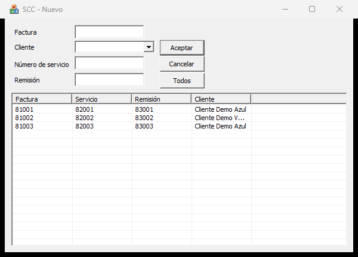
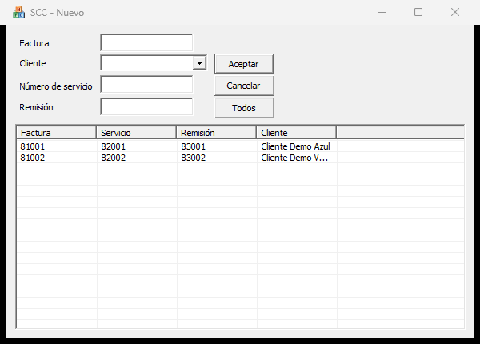

# SCC
[English](#english) · [Español](#español)

## English


Legacy Win32 application for recording and looking up invoices, service references and delivery slips

> [!WARNING]
> **Status: Legacy.** This archive contains a Win32 dialog and a Docker example with fictional records.

### Overview

SCC keeps a list of invoices by customer. It records the service number used to identify the work and can link it to the delivery slip, the document that accompanies a delivery.

### Features

- Choose a customer and enter an invoice number, service reference and delivery slip, then select **Aceptar**.
- Use **Todos** to show saved records in the table.
- Choose a customer from the drop-down to narrow down the displayed records.

### Requirements

Windows 11 with Desktop development with C++ and MFC for x86. Verified with Visual Studio Community 2026 18.10.3, MSBuild 18.10.1.42706, MSVC v145 14.51.36231, Windows SDK 10.0.26100.0. The demo uses Docker Engine 29.9.2, PowerShell 7.6.9, MySQL server 8.4.13 and the Win32 MySQL client 5.0.16. The 2009 shared-library sources include Conector 3.0.0.1, Componentes 2.1.0.1 and LAppc 1.1.0.1. The older recovered Conector releases lack the query and message classes used by SCC. The solution adapts the recovered libraries to v145 and leaves out optional hyperlink and custom message controls. Componentes reads the x86 `mshtml.tlb` provided by Windows in `SysWOW64`. The adapted libraries can start from the newly compiled files without the historical installer metadata. They still verify module integrity when that metadata exists.

### Getting started

Download the official [MySQL 5.0.16 Win32 ZIP](https://downloads.mysql.com/archives/get/p/23/file/mysql-noinstall-5.0.16-win32.zip) and extract it. Its SHA-256 is `7fd196125358d82817d4406b282cb95f9068723e526f29c68e1b1805130e5392`. Copy `include/` to the SDK directory and copy `lib/opt/libmysql.lib` and `lib/opt/libmysql.dll` from the ZIP to the SDK directory itself. Run these commands from the repository root in Developer PowerShell for Visual Studio. The demo script starts a disposable database, sets temporary connection variables and removes the container when SCC closes.

```powershell
$env:MySqlSdkDir = 'C:\sdk\mysql-5.0.16'
MSBuild SCC.sln /m:3 /t:Rebuild /p:Configuration=Release /p:Platform=Win32 /p:MySqlSdkDir="$env:MySqlSdkDir" /p:ThemeSdkDir="$PWD\compat"
Copy-Item "$env:MySqlSdkDir\libmysql.dll" .\bin\Release\
& .\examples\mysql-demo.ps1
```

### Usage

Select **Todos** to display two fictional invoices. Choose `Cliente Demo Azul`, enter invoice `81003`, service `82003` and delivery slip `83003`, then select **Aceptar**. Select **Todos** again to see the new row.

### Project structure

`src/SCC/SCCDlg.cpp` implements the dialog. The solution at the root pairs the converted projects with the app. `src/SCC/SCC.sln` preserves the historical solution. `vendor/` contains the shared-library adaptations. `compat/tmschema.h` connects the older theme header name to the current Windows SDK. `examples/mysql-demo.ps1` starts the test database. `docs/media/` contains captures from the example.

### Contributing

Keep examples fictional and name the command or dialog you tested when proposing a change.

### Support

Use the repository’s Issues to report build problems and reproducible issues with the example.

### History

The February 2007 snapshot recovers the original dialog. The 2026 reconstruction converted the Win32 project, moved the database credentials to environment variables and adapted the closest complete shared-library sources found. The earlier archives lack the Conector query and message classes used by this version. The demo schema comes from the SCC archive and the records were created for the test.

### Document references

The customer ID connects each invoice row to a customer. The operation uses the service number as the key when reopening an existing record. `examples/schema.sql` defines both tables and `examples/fictional-data.sql` loads two example rows.

### Verification

On November 18, 2026, each commit built on Windows 11 Pro build 26300 using Visual Studio Community 2026 18.10.3, MSBuild 18.10.1.42706, MSVC v145 14.51.36231, Windows SDK 10.0.26100.0. The command above rebuilt its own `SCC.sln` with Win32 Release and code 0. With Docker Engine 29.9.2, a MySQL 8.4.13 loopback server and the 5.0.16 client, the executable listed two seeded invoices and inserted a third. The server returned all four expected values. SCC closed from its dialog with code 2.



The report includes invoice 81003.



The application starts with two records and then shows the one entered in the form.

### License

The [MIT License](LICENSE) covers the project contributions. See [third-party notices](THIRD-PARTY-NOTICES.md) for the other components.

---

## Español


Legado de una aplicación Win32 para registrar y consultar facturas, servicios y comprobantes de entrega

> [!WARNING]
> **Estado: legado.** Este archivo contiene una ventana Win32 y un ejemplo en Docker con registros ficticios.

### Descripción general

SCC lleva una lista de facturas por cliente. Registra el número de servicio que identifica el trabajo y permite asociarlo a la remisión, el comprobante que acompaña una entrega.

### Funciones

- Elige un cliente, escribe la factura, el número de servicio y la remisión, y pulsa **Aceptar**.
- Usa **Todos** para consultar en la tabla los registros guardados.
- Elige un cliente del desplegable para consultar sus registros.

### Requisitos

Windows 11 con Desarrollo para el escritorio con C++ y MFC para x86. Verificado con Visual Studio Community 2026 18.10.3, MSBuild 18.10.1.42706, MSVC v145 14.51.36231, Windows SDK 10.0.26100.0. La demostración usa Docker Engine 29.9.2, PowerShell 7.6.9, servidor MySQL 8.4.13 y el cliente MySQL Win32 5.0.16. Los fuentes compartidos de 2009 incluyen Conector 3.0.0.1, Componentes 2.1.0.1 y LAppc 1.1.0.1. Las revisiones anteriores de Conector que se recuperaron carecen de las clases de consultas y mensajes usadas por SCC. La solución adapta las bibliotecas a v145 y excluye los controles opcionales de hipervínculos y mensajes personalizados. Componentes usa `mshtml.tlb` x86, provisto por Windows en `SysWOW64`. Las bibliotecas adaptadas pueden arrancar desde los archivos recién compilados sin los metadatos del instalador histórico. Siguen comprobando la integridad de los módulos si esos metadatos están presentes.

### Cómo empezar

Descarga el [ZIP oficial de MySQL 5.0.16 para Win32](https://downloads.mysql.com/archives/get/p/23/file/mysql-noinstall-5.0.16-win32.zip) y extráelo. Su SHA-256 es `7fd196125358d82817d4406b282cb95f9068723e526f29c68e1b1805130e5392`. Copia `include/` dentro de la carpeta del SDK y coloca `lib/opt/libmysql.lib` y `lib/opt/libmysql.dll` del ZIP en la carpeta del SDK. Ejecuta desde la raíz en Developer PowerShell para Visual Studio. El script crea una base desechable, configura las variables temporales de conexión y elimina el contenedor cuando cierras SCC.

```powershell
$env:MySqlSdkDir = 'C:\sdk\mysql-5.0.16'
MSBuild SCC.sln /m:3 /t:Rebuild /p:Configuration=Release /p:Platform=Win32 /p:MySqlSdkDir="$env:MySqlSdkDir" /p:ThemeSdkDir="$PWD\compat"
Copy-Item "$env:MySqlSdkDir\libmysql.dll" .\bin\Release\
& .\examples\mysql-demo.ps1
```

### Uso

Pulsa **Todos** para ver dos facturas ficticias. Elige `Cliente Demo Azul`, escribe factura `81003`, servicio `82003` y remisión `83003`, y pulsa **Aceptar**. Pulsa **Todos** de nuevo para ver la fila nueva.

### Estructura del proyecto

`src/SCC/SCCDlg.cpp` implementa el diálogo. La solución de la raíz integra los proyectos convertidos de la aplicación y sus bibliotecas. `src/SCC/SCC.sln` conserva la solución histórica. `vendor/` contiene las adaptaciones de las bibliotecas. `compat/tmschema.h` conecta el encabezado antiguo de temas con el SDK actual de Windows. `examples/mysql-demo.ps1` inicia la base de prueba. `docs/media/` contiene las capturas del ejemplo.

### Contribuir

Usa datos ficticios en los ejemplos e indica el comando o el diálogo que probaste al proponer un cambio.

### Soporte

Usa la sección Issues para reportar problemas de compilación o fallos reproducibles del ejemplo.

### Historia

La versión de febrero de 2007 recupera el diálogo original. La reconstrucción de 2026 convirtió el proyecto Win32, pasó las credenciales a variables de entorno y adaptó el respaldo completo de bibliotecas compartidas más cercano que se encontró. Los respaldos anteriores carecen de las clases de consultas y mensajes de Conector que usa esta versión. El esquema de la demostración procede del respaldo de SCC y los registros se crearon para la prueba.

### Referencias de documentos

El identificador de cliente relaciona cada factura con un cliente. La operación usa el número de servicio como clave al abrir un registro existente. `examples/schema.sql` define ambas tablas y `examples/fictional-data.sql` carga dos filas de ejemplo.

### Verificación

El 18 de noviembre de 2026, cada commit compiló en Windows 11 Pro compilación 26300 con Visual Studio Community 2026 18.10.3, MSBuild 18.10.1.42706, MSVC v145 14.51.36231, Windows SDK 10.0.26100.0. El comando anterior recompiló su propia `SCC.sln` en Release Win32 y devolvió código 0. Con Docker Engine 29.9.2, un servidor MySQL 8.4.13 en la interfaz local y el cliente 5.0.16, el ejecutable mostró dos facturas de ejemplo y guardó una tercera. El servidor devolvió los cuatro valores esperados. SCC se cerró desde su diálogo con código 2.


El listado incluye la factura 81003.


La aplicación empieza con dos registros y luego muestra el que se introdujo en el formulario.

### Licencia

La [licencia MIT](LICENSE) cubre los aportes del proyecto. Consulta los [avisos de terceros](THIRD-PARTY-NOTICES.md) para los demás componentes.
